# SpareLook

### Equipment sharing, without the chaos.

SpareLook is a platform that helps an institution **discover, request, approve, share and track** camera and technical equipment, with conflict-free booking, transparent ranking and a full accountability trail. Every step from catalogue to return is recorded, and every action is authorized on the server.


> **Project status.** SpareLook is a **fictional, single-institution demo** for evaluation. It is **not deployed** and **not production-ready**. All institutions, people, emails (`@riverbend-demo.example`, a reserved non-routable domain), asset tags and bookings are synthetic sample data.

## Contents

- [Product screenshots](#product-screenshots)
- [Problem and solution](#problem-and-solution)
- [Key features](#key-features)
- [Product workflow](#product-workflow)
- [Architecture](#architecture)
- [Technology stack](#technology-stack)
- [Installation and local setup](#installation-and-local-setup)
- [Demo accounts and judge walkthrough](#demo-accounts-and-judge-walkthrough)
- [Testing and verification](#testing-and-verification)
- [Security and privacy](#security-and-privacy)
- [Implementation status and limitations](#implementation-status-and-limitations)
- [Additional documentation](#additional-documentation)

---

## Product screenshots

Real 1440×900 captures from the production build running against the isolated fictional demo database (captured 2026-10-31). No passwords, tokens or real personal data are visible.

### 01. Landing page
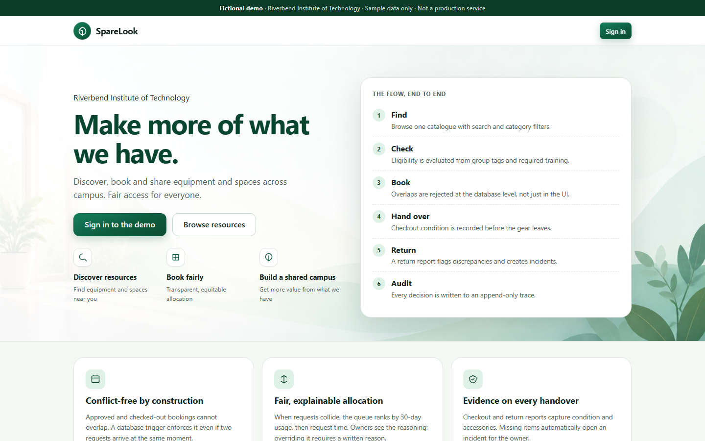

### 02. Resource discovery
Catalogue with search and category filters.

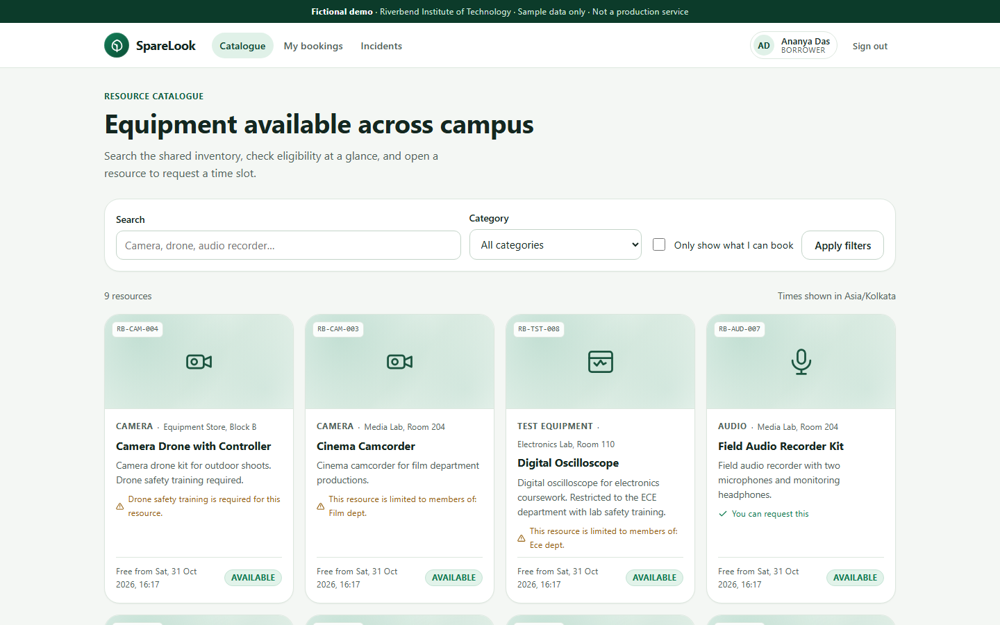

### 03. Resource details
Eligibility explanation, availability and the booking request form.

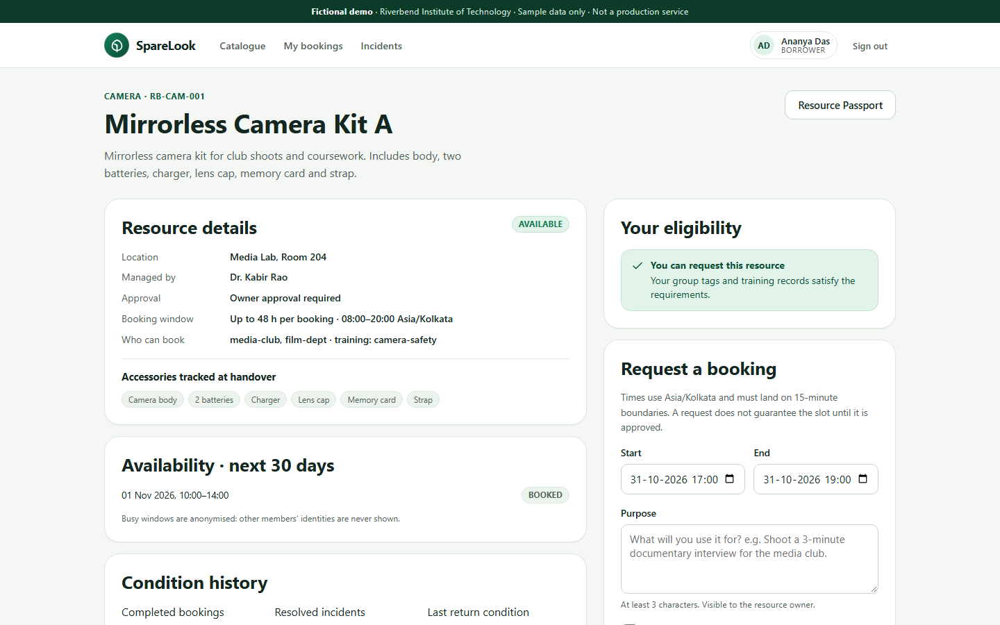

### 04. Booking status timeline
Booking detail with a progress and status timeline built from real history.

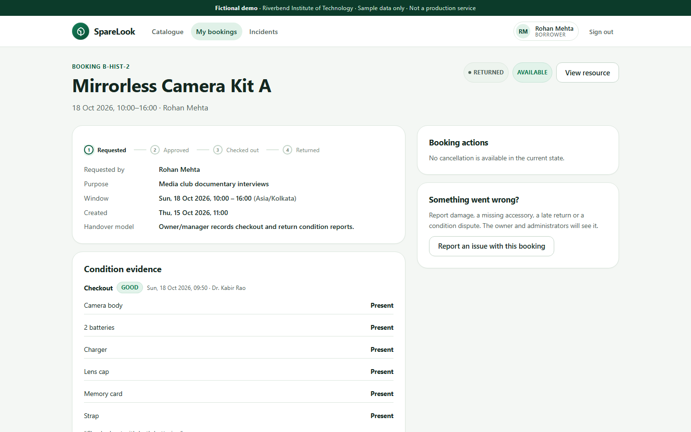

### 05. FairShare and waitlist
Live waitlist position with a rule-based explanation.

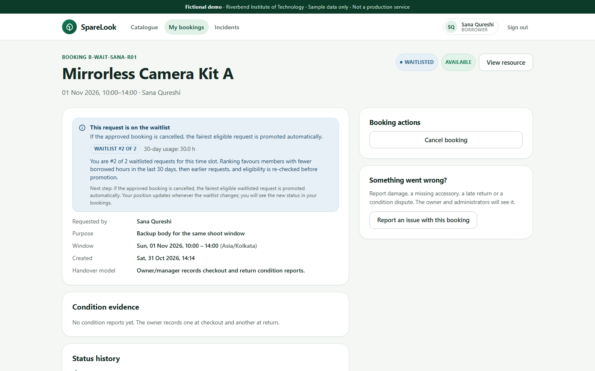

### 06. Owner dashboard
Owner request queue with FairShare ranking.

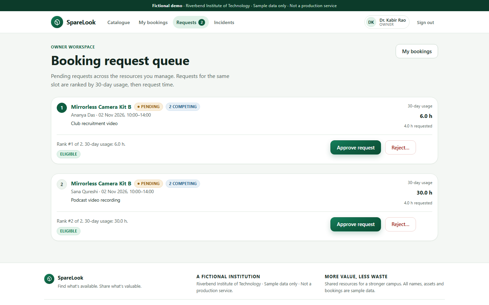

### 07. Checkout and return
Checkout evidence and the return condition workflow.

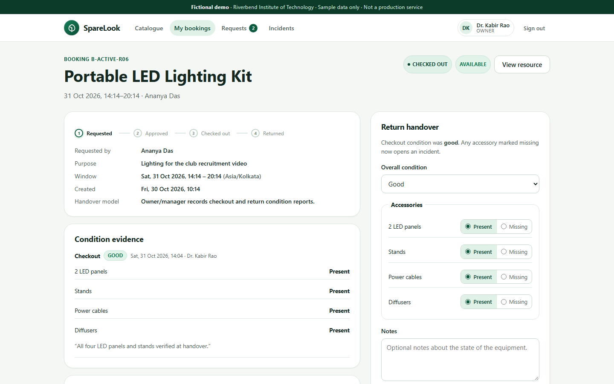

### 08. Incident history
Incident detail with manager-visible status history.

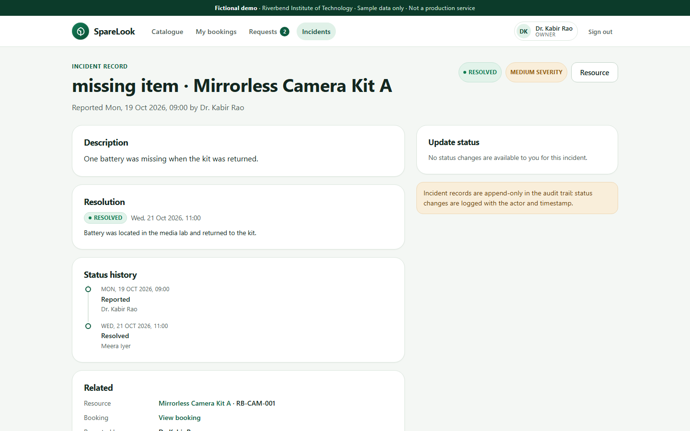

### 09. Admin dashboard
Admin resource management table.

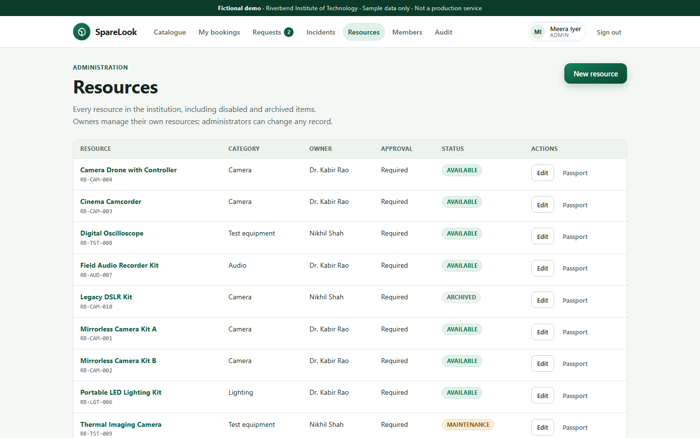

---

## Problem and solution

**The problem.** Small institutions (departments, clubs, labs) often share expensive equipment through spreadsheets, chat threads and paper sign-out sheets. The same failures repeat:

- Double bookings are discovered at pickup.
- Eligibility rules are applied inconsistently.
- Condition and damage history is lost between borrowers.
- There is no fair, auditable way to choose between competing requests.

**Target users.**

- **Borrowers** (students and club members) who need to find eligible equipment and book it without conflicts.
- **Owners / managers** who approve requests, run checkout and return, and handle incidents.
- **Institution admins** who manage the catalogue, users and audit trail.

**The solution.** SpareLook models one institution and covers the whole loop in one system: catalogue, eligibility, conflict-free request, owner decision or waitlist, checkout condition report, return condition report, incident, resource history and audit trail. Conflicts are rejected by the database itself, competing requests are ranked by a deterministic FairShare rule, and every decision leaves an append-only record.

## Key features

| Feature | Status |
| --- | --- |
| Sign-in / sign-out, server-side sessions, role and tenant authorization | Implemented |
| Equipment catalogue with search, type / location / eligibility filters, pagination | Implemented |
| Resource detail, availability and eligibility explanation | Implemented |
| Booking requests with validation, idempotency and usage limits | Implemented |
| Conflict prevention (database triggers plus `BEGIN IMMEDIATE`) | Implemented |
| Owner approval and rejection with reasons | Implemented |
| FairShare ranking, with a required reason to override the ranking | Implemented |
| Waitlist, live position and promotion | Implemented |
| Booking status timeline from real history | Implemented |
| Checkout and return condition reports with discrepancy detection | Implemented |
| Incident management with status lifecycle and manager-visible history | Implemented |
| Resource Passport (role-filtered resource history) | Implemented |
| Append-only audit trail and admin audit page | Implemented |
| Admin resource create / edit / status / owner assignment | Implemented |
| Admin user tags, suspension and audit filters | Partially Implemented (routes and UI exist; no test or click-through recorded) |

## Product workflow

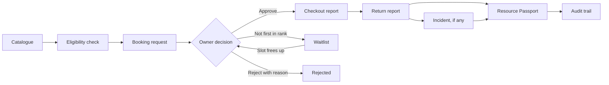

Approval of a request ranked below first requires an override reason; competing requests become `WAITLISTED`. Resources flagged auto-approve skip the owner step.

## Architecture

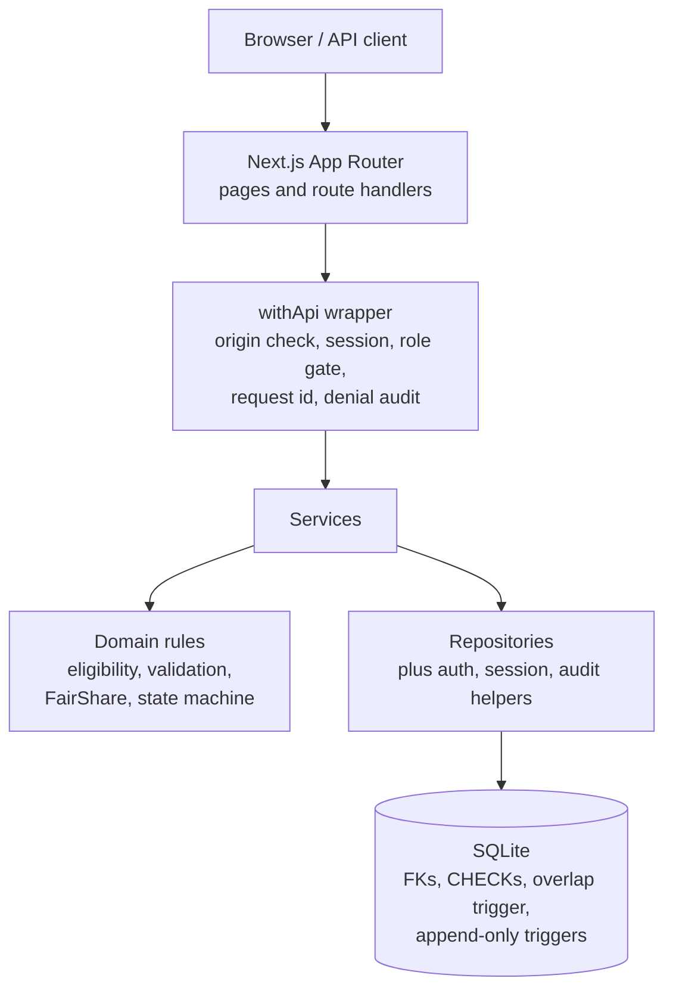

- **Next.js App Router** serves pages, route handlers and server actions (`src/app`).
- **`withApi`** is deny-by-default: it checks origin, session and role, adds a request id, and audits denials.
- **Services** (`src/server/services`) apply object-level authorization and orchestrate domain rules.
- **Domain layer** (`src/domain`) holds pure rules: policy, eligibility, validation, FairShare and the booking state machine.
- **Repositories** (`src/server/repos`) take `institutionId` and filter every query by it.
- **SQLite** enforces foreign keys, CHECK constraints, an overlap trigger for `APPROVED` / `CHECKED_OUT` bookings and append-only triggers on audit, booking, report and incident rows.
- All timestamps are stored in UTC and converted using the institution time zone (`Asia/Kolkata` by default).

## Technology stack

| Layer | Choice | Version |
| --- | --- | --- |
| Runtime | Node.js | 24.11.1 at first build (24.18.0 for the final hardening run) |
| Package manager | npm | 11.6.2 |
| Framework | Next.js App Router (Turbopack) | 16.4.3 |
| UI | React | 19.3.1 |
| Language | TypeScript (strict) | 5.9.2 |
| Database | SQLite via better-sqlite3 (WAL) | 13.0.3 |
| Validation | Zod | 4.6.7 |
| Password hashing | bcryptjs | 3.0.3 |
| Icons | lucide-react | 1.65.0 |
| Tests | vitest | 5.0.5 |
| Script runner | tsx | 4.23.15 |

Also used for tooling: ESLint, Prettier and Playwright (E2E harness in `scr/_harness`). Styles are hand-written CSS; no CSS framework or component template is used.

PostgreSQL was the preferred database but was not used because Docker and a local `psql` were not available; SQLite was the allowed fallback (see [`docs/DECISIONS.md`](docs/DECISIONS.md)).

## Installation and local setup

Requires Node.js and npm. The recorded runs used Node.js 24.x and npm 11.6.2.

### 1. Clone and install

```bash
git clone https://github.com/aakashimportant15-max/sparelook.git
cd sparelook
npm install
```

### 2. Configure the environment

**Windows PowerShell**

```powershell
Copy-Item .env.example .env
notepad .env
```

**macOS / Linux / other terminals**

```bash
cp .env.example .env
```

In `.env`, set `DEMO_USER_PASSWORD` to a password of your choice. If it is left empty, the seed script generates one and prints it once to the local console. Never commit `.env`; it is git-ignored.

| Variable | Purpose | Default |
| --- | --- | --- |
| `SHARESPACE_DB_PATH` | SQLite file path | `./data/sharespace.db` |
| `INSTITUTION_TIMEZONE` | IANA time zone for input and display | `Asia/Kolkata` |
| `SESSION_IDLE_HOURS` | Session idle timeout | `8` |
| `SESSION_ABSOLUTE_HOURS` | Session absolute lifetime | `24` |
| `DEMO_USER_PASSWORD` | Password for all seeded demo accounts (local only) | empty |
| `APP_ORIGIN` | Allowed origin for CSRF checks; `Secure` cookie flag when https | `http://localhost:3000` |

### 3. Reset, migrate and seed the demo database

```bash
npm run demo:reset
```

This runs `db:reset`, `db:migrate` and `db:seed`. Relative demo dates are re-anchored to the current day on each reset. `db:reset` refuses to run when `NODE_ENV=production` and refuses to delete a database outside `./data` or the OS temp directory unless `CONFIRM_DB_RESET=yes` is set.

### 4. Run

Development:

```bash
npm run dev
```

Production mode locally:

```bash
npm run build
npm start
```

The app is served at `http://localhost:3000`.

### 5. Health check

```bash
curl http://localhost:3000/api/health
```

On Windows PowerShell, use `curl.exe http://localhost:3000/api/health` or `Invoke-RestMethod http://localhost:3000/api/health`.

## Demo accounts and judge walkthrough

All accounts are fictional and share the single password you set in `DEMO_USER_PASSWORD`. **No credentials are published.**

| Name | Email | Role |
| --- | --- | --- |
| Meera Iyer | `meera@riverbend-demo.example` | Admin |
| Dr. Kabir Rao | `kabir@riverbend-demo.example` | Owner (camera and audio) |
| Nikhil Shah | `nikhil@riverbend-demo.example` | Owner (test equipment) |
| Ananya Das | `ananya@riverbend-demo.example` | Borrower (media-club, camera-safety) |
| Rohan Mehta | `rohan@riverbend-demo.example` | Borrower (media-club, camera-safety) |
| Isha Kulkarni | `isha@riverbend-demo.example` | Borrower (film-dept, camera and drone safety) |
| Dev Malhotra | `dev@riverbend-demo.example` | Borrower with no group or training (ineligible demo) |
| Sana Qureshi | `sana@riverbend-demo.example` | Borrower (media-club; seeded heavy usage) |

**Suggested walkthrough**

1. **Borrower.** Sign in as Ananya, open resource **R01** in the catalogue and review eligibility, availability and the live waitlist note. Open **My bookings** for the status timeline, then the waitlisted booking to see its real position and explanation.
2. **Owner.** Sign in as Kabir, open `/manage/requests` and approve, check out and return. Open **Incidents** to see an incident with its status history.
3. **Admin.** Sign in as Meera and visit `/admin/resources`, `/admin/users` and `/admin/audit`.
4. **Ineligible borrower.** Sign in as Dev to see requests blocked with missing group and training reasons.

**Scripted demo (D1–D12).** `npx tsx scripts/demo-run.ts` runs twelve steps over the real HTTP API with six personas. Run it only against a freshly seeded database and reset afterwards:

```bash
npm run demo:reset
npm start                     # in another terminal
npx tsx scripts/demo-run.ts
npm run demo:reset
```

## Testing and verification

Results below are copied from [`docs/TEST_REPORT.md`](docs/TEST_REPORT.md). Only runs that were executed are listed as passed.

### Executed and passed

| Check | Result | Date |
| --- | --- | --- |
| Unit and integration (`npm test`) | 141 / 141 passed, 16 files | 2026-10-31 |
| Concurrency (`npm run test:concurrency`) | 40 / 40 rounds passed, 4 processes per round | 2026-10-31 |
| Type check (`npm run typecheck`) | Passed, 0 errors | 2026-10-31 |
| Lint (`npm run lint`) | Passed, 0 errors | 2026-10-31 |
| Production build (`npm run build`) | Passed, 1 non-fatal Turbopack tracing warning | 2026-10-31 |
| Playwright `specs/06-*.spec.ts` | 10 / 10 passed | 2026-10-31 |
| Playwright `specs/07-redesign.spec.ts` | 11 / 11 passed | 2026-10-31 |
| HTTP smoke (`scripts/smoke-http.ts`) | 14 / 14 checks | 2026-10-30 |
| DB trigger smoke (`scripts/smoke-check.ts`) | 3 / 3 checks | 2026-10-30 |
| Demo workflow D1–D12 (`scripts/demo-run.ts`) | 28 / 28 steps | 2026-10-30 |
| Mobile browser checks, 360×800 (`scripts/browser-check.ts`) | 15 / 15 checks | 2026-10-30 |
| UI click-through (`scripts/ui-journey.ts`) | 8 / 8 steps (UI-01, UI-03 approve, UI-06) | 2026-10-30 |
| Dependency audit (`npm audit --omit=dev`) | 0 vulnerabilities | 2026-10-30 |
| Format check (`npm run format:check`) | Passed on 2026-10-30; the later hardening pass reports style drift in 26 pre-existing files (see report) | 2026-10-30 |

The multi-process concurrency runs cover **creation races** (20 rounds producing exactly one `APPROVED` and three `BOOKING_CONFLICT` results, and 20 idempotency-replay rounds).

### Not verified

These are gaps, not passes:

- axe accessibility scan, contrast script, and a full keyboard-only journey
- Reduced-motion behaviour and 44 px touch-target measurement
- UI click-through for conflict / waitlist (UI-02), checkout / return (UI-04) and Passport (UI-05)
- Parallel **approve** race (TC-CONC-01)
- HTTP-level 429 after repeated failed sign-ins
- XSS rendering test (TC-SEC-05), stale-approval re-check (TC-BOOK-08), audit-metadata minimization test (TC-AUD-02)
- Every non-public endpoint returning 401 without a session
- Admin user tags, suspension and audit filters
- Fresh-clone setup (SMOKE-01) and double-seed determinism (SMOKE-02)

The final checklist states that the acceptance gate is **not fully satisfied**; see [`docs/FINAL_CHECKLIST.md`](docs/FINAL_CHECKLIST.md).

## Security and privacy

A control-by-control walkthrough is in [`docs/SECURITY_REVIEW.md`](docs/SECURITY_REVIEW.md). This is a self-review of an MVP, not a formal audit or certification.

- **Authentication.** Passwords are hashed with bcryptjs. Sign-in failures return one generic error for wrong password and unknown email.
- **Sessions.** Tokens are 256-bit random values; only a SHA-256 hash is stored. Sessions expire after 8 h idle / 24 h absolute (configurable). Sign-out and suspension revoke sessions server-side. The cookie is `httpOnly`, `SameSite=Lax`, and `Secure` when `APP_ORIGIN` is https.
- **Authorization.** Enforced on the server in `withApi` and the service layer, not only by hiding UI controls. Foreign objects return 404 instead of confirming existence. Denied sensitive attempts are audited.
- **Tenant isolation.** Every repository filters by `institution_id`; isolation is tested against a second institution.
- **Database integrity.** Foreign keys, CHECK constraints, an overlap trigger and append-only triggers.
- **Input validation.** Zod on every mutation; SQL uses bound parameters.
- **Origin checks.** Non-GET requests carrying an `Origin` header are checked against `APP_ORIGIN`.
- **Audit trail.** Append-only at the database level.
- **Dependencies.** `npm audit` reported 0 vulnerabilities on 2026-10-30.
- **Secrets.** `.env` is git-ignored; `.env.example` holds placeholders only.

**Known security limitations**

- The audit trail is protected by database triggers and is **not cryptographically tamper-proof**; anyone with write access to the SQLite file can alter it.
- The origin check is skipped when no `Origin` header is sent, and there is no CSRF token.
- The CSP allows `script-src 'unsafe-inline'` because Next.js injects inline bootstrap scripts.
- Rate limiting is in-memory and per process, and resets on restart.
- The demo runs over HTTP on localhost; production use would need HTTPS and a matching `APP_ORIGIN`.
- Condition-report notes do not carry the personal-information warning that the incident form has.
- The application is not claimed to be fully secure, and no penetration test or compliance certification exists.

## Implementation status and limitations

### Implemented
Authentication and sessions, role and tenant authorization, catalogue and filters, eligibility, booking requests with idempotency and limits, database-level conflict prevention, approval and rejection, FairShare ranking and override, waitlist and promotion, status timeline, condition reports, incidents, Resource Passport, audit trail, admin resource management.

### Partially Implemented
- Admin user tags, suspension and audit filters: routes and UI exist, with no test or click-through.
- Accessibility: sign-in error announcement and catalogue tab order were checked; nothing broader.
- Security: input escaping relies on React defaults without a dedicated test; CSRF and rate limiting have the limits listed above.

### Planned
- Catalogue date-range availability filter (availability is currently shown on the resource detail page).
- Photo or attachment evidence for condition reports (currently structured conditions, an accessory checklist and notes only).
- Automated consequences for late returns or damage (currently recorded for humans to act on).
- Notifications, password reset, self-service accounts and email delivery.
- Production deployment and HTTPS setup.

### Not Verified
See the list under [Testing and verification](#testing-and-verification).

### Not Implemented
- **AI Resource Matchmaker.** It is **not implemented**. No AI is integrated; catalogue search and filtering are deterministic keyword and field filters, and FairShare ranking is deterministic.

### Other known limitations
- Single-institution demo: the schema carries `institution_id` and isolation is tested, but there is no institution-management UI.
- SQLite on a single process: correctness is verified at demo scale and is not a production-scale concurrency claim.
- Route handlers are covered by script-level HTTP tests rather than unit tests.
- The production build prints one non-fatal Turbopack tracing warning (database path resolved from the working directory).
- Demo data is time-relative, so `npm run demo:reset` changes absolute dates by design.

### Project information not provided
Team members and contributions, license, deployment URL, and official hackathon rules and submission details have not been supplied and are intentionally left unstated.

**Build process disclosure.** An AI coding assistant (Qoder) was used to implement, test and document this repository. `background.png` was supplied by the project owner and is used unmodified.

## Additional documentation

| Document | Contents |
| --- | --- |
| [`docs/TEST_REPORT.md`](docs/TEST_REPORT.md) | Every executed run, counts, failures, per-case mapping and gaps |
| [`docs/SECURITY_REVIEW.md`](docs/SECURITY_REVIEW.md) | Security controls, abuse cases and remaining risks |
| [`docs/FINAL_CHECKLIST.md`](docs/FINAL_CHECKLIST.md) | Completed, verified, pending and unverified items |
| [`docs/ASSUMPTIONS.md`](docs/ASSUMPTIONS.md) | Assumptions and open owner decisions |
| [`docs/DECISIONS.md`](docs/DECISIONS.md) | Design decisions, including the SQLite choice |
| [`docs/PROGRESS.md`](docs/PROGRESS.md) | Progress log |
| [`docs/TASKS.md`](docs/TASKS.md) | Task register |

Run logs and screenshots are under `docs/evidence/`; final page screenshots are under `docs/screenshots/important-pages/`.
